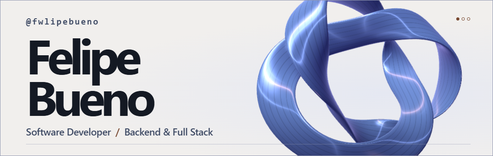
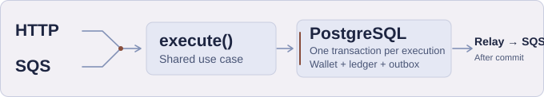
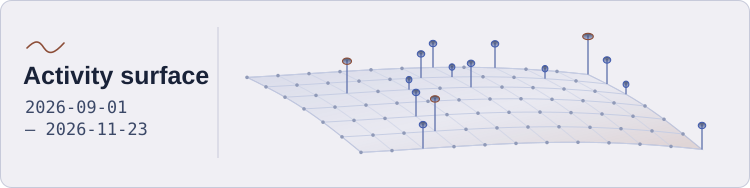

<picture>
  <source media="(max-width: 600px) and (prefers-color-scheme: dark) and (prefers-reduced-motion: no-preference)" type="image/webp" srcset="./assets/hero-mobile-dark-motion.webp">
  <source media="(max-width: 600px) and (prefers-color-scheme: light) and (prefers-reduced-motion: no-preference)" type="image/webp" srcset="./assets/hero-mobile-light-motion.webp">
  <source media="(max-width: 600px) and (prefers-color-scheme: dark)" srcset="./assets/hero-mobile-dark.png">
  <source media="(max-width: 600px)" srcset="./assets/hero-mobile-light.png">
  <source media="(prefers-color-scheme: dark) and (prefers-reduced-motion: no-preference)" type="image/webp" srcset="./assets/hero-desktop-dark-motion.webp">
  <source media="(prefers-color-scheme: light) and (prefers-reduced-motion: no-preference)" type="image/webp" srcset="./assets/hero-desktop-light-motion.webp">
  <source media="(prefers-color-scheme: dark)" srcset="./assets/hero-desktop-dark.png">
  
</picture>

[LinkedIn](https://www.linkedin.com/in/felipeabueno/) · [Português](./README.pt-BR.md) · Cornélio Procópio, Brazil

I build backend services and full-stack applications, and study Software Engineering at UTFPR. I’m interested in distributed systems, automation and applied AI.

##  Selected work

 **[Distributed Wagering Processor](https://github.com/fwlipebueno/distributed-wagering-processor/blob/main/README.en.md)** — HTTP and SQS call the same financial use case. Each execution uses its own PostgreSQL transaction for wallet and ledger updates. Persistent idempotency, inbox and outbox handle retries.

<picture>
  <source media="(max-width: 600px) and (prefers-color-scheme: dark)" srcset="./assets/transaction-mobile-dark.svg">
  <source media="(max-width: 600px)" srcset="./assets/transaction-mobile-light.svg">
  <source media="(prefers-color-scheme: dark)" srcset="./assets/transaction-dark.svg">
  
</picture>

[Architecture](https://github.com/fwlipebueno/distributed-wagering-processor/blob/main/ARCHITECTURE.md) · [Local validation: 43 unit and 29 integration tests](https://github.com/fwlipebueno/distributed-wagering-processor/blob/main/AUDIT.md)

 **[Meninas Digitais Simulator](https://github.com/fwlipebueno/meninas-digitais-simulator/blob/main/README.en.md)** — Full-stack team project for a UTFPR outreach program. I contributed to the interface, progress integration and tests. [Live simulator](https://meninas-digitais-simulator-web.onrender.com/).

 **[Orbital Directive](https://github.com/fwlipebueno/orbital-directive)** — The server owns the simulation state and updates resources through transactions. Idempotency keys handle repeated commands.

##  Toolkit

<picture>
  <source media="(max-width: 600px) and (prefers-color-scheme: dark)" srcset="./assets/toolkit-mobile-dark.svg">
  <source media="(max-width: 600px)" srcset="./assets/toolkit-mobile-light.svg">
  <source media="(prefers-color-scheme: dark)" srcset="./assets/toolkit-desktop-dark.svg">
  
</picture>

Public contribution surface

<picture>
  <source media="(prefers-color-scheme: dark)" srcset="./assets/activity-dark.svg">
  
</picture>

Public snapshot. One point per day, raised by contribution count. [Calendar on GitHub](https://github.com/fwlipebueno#js-contribution-activity).

