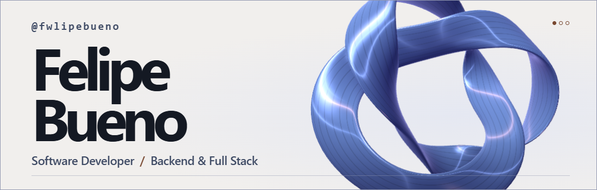
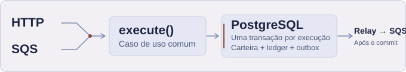
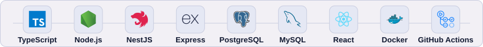
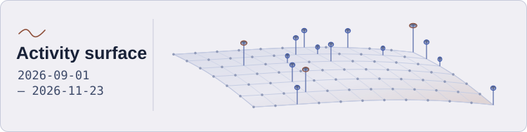

<picture>
  <source media="(max-width: 600px) and (prefers-color-scheme: dark) and (prefers-reduced-motion: no-preference)" type="image/webp" srcset="./assets/hero-mobile-dark-motion.webp">
  <source media="(max-width: 600px) and (prefers-color-scheme: light) and (prefers-reduced-motion: no-preference)" type="image/webp" srcset="./assets/hero-mobile-light-motion.webp">
  <source media="(max-width: 600px) and (prefers-color-scheme: dark)" srcset="./assets/hero-mobile-dark.png">
  <source media="(max-width: 600px)" srcset="./assets/hero-mobile-light.png">
  <source media="(prefers-color-scheme: dark) and (prefers-reduced-motion: no-preference)" type="image/webp" srcset="./assets/hero-desktop-dark-motion.webp">
  <source media="(prefers-color-scheme: light) and (prefers-reduced-motion: no-preference)" type="image/webp" srcset="./assets/hero-desktop-light-motion.webp">
  <source media="(prefers-color-scheme: dark)" srcset="./assets/hero-desktop-dark.png">
  
</picture>

[LinkedIn](https://www.linkedin.com/in/felipeabueno/) · [English](./README.md) · Cornélio Procópio, Brasil

Desenvolvo serviços backend e aplicações full stack e curso Engenharia de Software na UTFPR. Tenho interesse em sistemas distribuídos, automação e IA aplicada.

##  Projetos selecionados

 **[Distributed Wagering Processor](https://github.com/fwlipebueno/distributed-wagering-processor)** — HTTP e SQS chamam o mesmo caso de uso financeiro. Cada execução usa sua própria transação PostgreSQL para atualizar carteira e ledger. Idempotência persistida, inbox e outbox tratam reenvios.

<picture>
  <source media="(max-width: 600px) and (prefers-color-scheme: dark)" srcset="./assets/transaction-pt-mobile-dark.svg">
  <source media="(max-width: 600px)" srcset="./assets/transaction-pt-mobile-light.svg">
  <source media="(prefers-color-scheme: dark)" srcset="./assets/transaction-pt-dark.svg">
  
</picture>

[Arquitetura](https://github.com/fwlipebueno/distributed-wagering-processor/blob/main/ARCHITECTURE.md) · [Validação local: 43 testes unitários e 29 de integração](https://github.com/fwlipebueno/distributed-wagering-processor/blob/main/AUDIT.md)

 **[Meninas Digitais Simulator](https://github.com/fwlipebueno/meninas-digitais-simulator)** — Projeto full stack em equipe para uma iniciativa de extensão da UTFPR. Contribuí com a interface, a integração do progresso e os testes. [Abrir simulador](https://meninas-digitais-simulator-web.onrender.com/).

 **[Orbital Directive](https://github.com/fwlipebueno/orbital-directive)** — O servidor controla o estado da simulação e atualiza os recursos em transações. Chaves de idempotência tratam comandos repetidos.

##  Ferramentas

<picture>
  <source media="(max-width: 600px) and (prefers-color-scheme: dark)" srcset="./assets/toolkit-mobile-dark.svg">
  <source media="(max-width: 600px)" srcset="./assets/toolkit-mobile-light.svg">
  <source media="(prefers-color-scheme: dark)" srcset="./assets/toolkit-desktop-dark.svg">
  
</picture>

Superfície de contribuições públicas

<picture>
  <source media="(prefers-color-scheme: dark)" srcset="./assets/activity-dark.svg">
  
</picture>

Recorte público. Um ponto por dia, com altura conforme a contagem. [Calendário no GitHub](https://github.com/fwlipebueno#js-contribution-activity).

